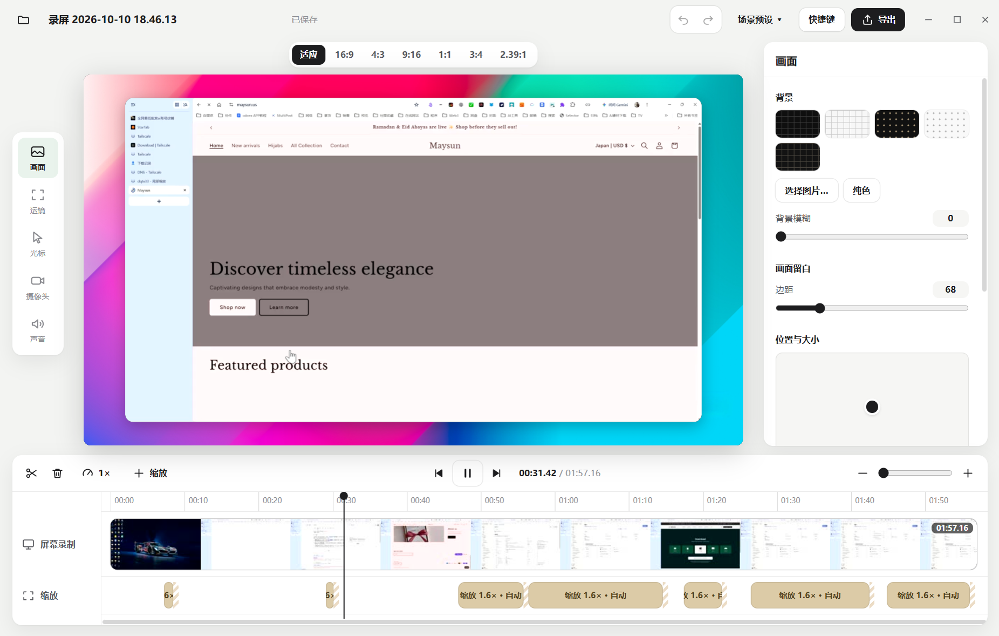

<p align="center">
  
</p>

<p align="center">
  <a href="windows/README.md"><strong>使用与开发说明</strong></a>
  · <a href="https://github.com/laogou717/dogsc">原作者项目 DogSC</a>
  · <a href="https://dqtx.cc">官网 dqtx.cc</a>
</p>

## 用录屏完成一条视频

Recly 是一款面向 Windows 的录屏与轻量剪辑工具。它把录制、自动跟随运镜、时间线编辑和导出放在一条工作流里，适合制作软件演示、操作教程和产品讲解。




## 能做什么

- **录制屏幕、窗口或自选区域**，可选择麦克风、摄像头和系统声音。
- **自动运镜跟随操作**：根据点击生成缩放片段，连续操作时镜头跟随指针；也能手动调整焦点、倍率和缓动。
- **编辑录制内容**：分割、裁短片段、变速、撤销与重做，并在时间线上查看录制内容。
- **调整画面**：设置画面比例、背景、留白、圆角和阴影，也可调整光标与摄像头画面。
- **导出成片**：输出 MP4 视频或 M4A 音频，并选择分辨率和帧率。

## 运行

### 直接启动

在 Windows 上下载或克隆仓库，双击 `windows/start.bat`。首次启动会安装运行依赖。录制与导出还需要系统可调用的 FFmpeg 6.0 或更新版本：

```powershell
winget install Gyan.FFmpeg
```

### 从源码启动

需要 Windows 10 2004 或更新版本、Node.js 20+ 和 FFmpeg 6.0+。

```powershell
cd windows
npm install
npm start
```

打包 Windows 免安装目录版：

```powershell
npm run package
```

程序入口为 `windows/dist/Recly-win32-x64/Recly.exe`。更完整的使用说明、自测方式、目录结构和已知限制见 [`windows/README.md`](windows/README.md)。

## 适配说明

Recly 的 Windows 版本以 Electron、FFmpeg 和 WebCodecs 实现录制及导出，并移植了原项目中的自动缩放、指针跟随、光标平滑和画面布局等核心逻辑。Windows 的窗口录制通过采集窗口可见区域实现，因此录制时目标窗口需要保持在原位且不被遮挡；Windows 项目文件也不与 macOS 原版互通。

## 原作者与许可

原版 DogSC 由 [神烦老狗（@laogou717）](https://github.com/laogou717) 创建，原项目和源码见 [laogou717/dogsc](https://github.com/laogou717/dogsc)。原作者未发布或背书 Recly 的 Windows 版本；原版版权声明与 MIT 许可见 [`LICENSE`](LICENSE)。再分发时请保留原作者的版权声明，字体等附带资源遵循各自许可。

## 👨‍💻 关于我

**大强同学（Derek Zhao）**
AI 工具与工作流实践者 · GitHub 开源项目作者

我在 Windows、AI Agent、Obsidian 和个人网站这些真实场景里，
把能跑通的工具、Skill 和流程，整理成可复用的开源项目与交付方案。

- 文章与工具：[dqtx.cc](https://www.dqtx.cc/) · [os.dqtx.cc](https://os.dqtx.cc/) · [blog.dqtx.cc](https://blog.dqtx.cc/)
- 关注更新：[B 站](https://space.bilibili.com/491358682/upload/video) · [YouTube](https://www.youtube.com/@dqtx760/videos) · [即刻](https://web.okjike.com/u/24236868-c3e9-49ef-ab93-93a60e1a25db) · [CSDN](https://blog.csdn.net/2402_82616859?type=blog)
- 公众号：微信搜索「大强同学」


卡在安装、配置、报错，或想把 AI 接进自己的工作流，可以直接找我。

**本软件是参考了原作者的代码进行改版，仅支持 Windows。**
