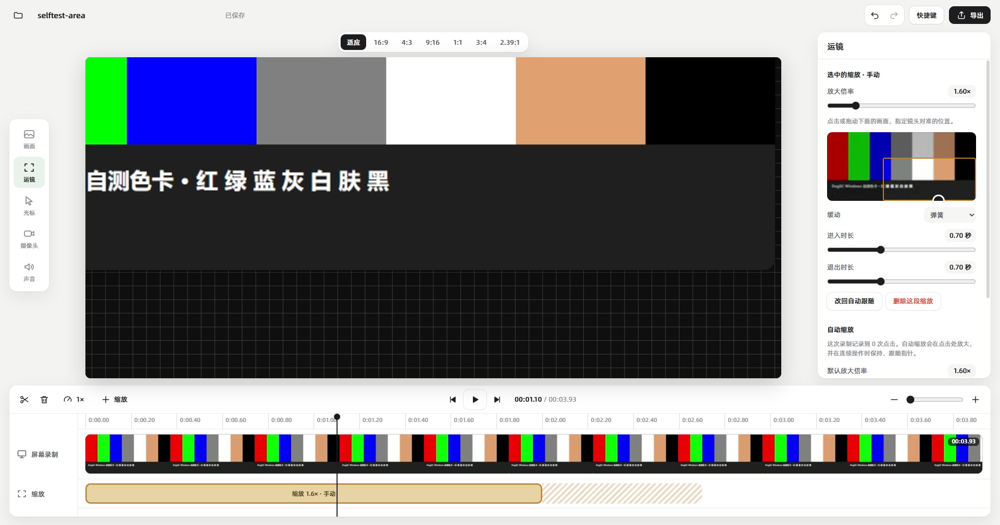

<p align="center">
  
</p>

<h1 align="center">DogSC · Windows 适配版</h1>

<p align="center">录屏与轻量编辑工具：录制、剪辑、运镜，到导出成片。</p>

<p align="center">
  <a href="windows/README.md"><strong>Windows 版使用说明</strong></a>
  · <a href="#怎么用">怎么用</a>
  · <a href="https://github.com/laogou717/dogsc">原版仓库（macOS）</a>
</p>

> [!NOTE]
> **原创作者：神烦老狗（[@laogou717](https://github.com/laogou717)）· 原仓库：[laogou717/dogsc](https://github.com/laogou717/dogsc)**
>
> DogSC 是神烦老狗原创的 macOS 录屏与编辑工具，以 [MIT License](LICENSE) 开源。产品设计、界面与交互、macOS 版的全部源码和资源都出自原作者，版权归原作者所有。
>
> 本仓库 fork 自原仓库，只新增了 [`windows/`](windows/README.md) 目录里的 Windows 适配，没有改动原版源码。Windows 适配**不是原作者的官方发布**，同样以 MIT License 开源；使用中遇到的问题请不要提到原仓库。

## 这是什么

原版 DogSC 是 macOS 原生应用（Swift），不能直接在 Windows 上运行。这个仓库把它适配到了 Windows：外壳换成 Electron，采集和编码换成 ffmpeg 与 WebCodecs，原版核心算法（自动缩放、自动跟随镜头、光标平滑、画面布局）按原公式和默认参数移植。

录制 → 剪辑 → 运镜 → 导出 这条主线可以完整走通。




<sub>截图来自 Windows 适配版，素材是自测用的色卡，不含个人录制内容。</sub>

## 功能

- **录制**：整块屏幕、单个窗口、自选区域；摄像头、麦克风、系统声音各自成轨。录制条和悬浮备忘录不会被录进画面，`Ctrl+Alt+M` 可在录制中留下剪辑标记。
- **运镜**：按点击自动生成缩放，连续操作时镜头保持并跟随指针；也可以手动添加缩放，调整倍率、焦点、缓动和进出时长。
- **剪辑**：时间线分割、拖边裁短与恢复、删除、变速，带缩略图，支持撤销和重做。
- **光标与摄像头**：光标重新合成，可调大小、平滑、静止隐藏和点击反馈；摄像头可调形状、大小、位置、镜像、描边和阴影。
- **画面设计**：比例、留白、圆角、描边、阴影；背景支持图案、Windows 壁纸、自选图片和纯色。
- **导出**：MP4 视频与 M4A 音频；原始分辨率、1080p、1440p、4K；30 / 60 FPS；显示进度和预计剩余时间，可随时取消。

## 怎么用

需要 Windows 10 2004 及以上（建议 Windows 11）、[Node.js](https://nodejs.org) 20 以上，以及 PATH 里的 ffmpeg 6.0 以上完整版：

```bash
winget install Gyan.FFmpeg
```

下载或克隆本仓库后，双击 `windows/start.bat` 即可启动（第一次会自动安装依赖）。也可以用命令行：

```bash
cd windows
npm install
npm start
```

想要一个可以直接双击的 `DogSC.exe`，在 `windows` 目录执行 `npm run package`，产物在 `windows/dist/DogSC-win32-x64/`。

录制的项目保存在 `视频\DogSC\` 下。完整说明、验证方法和目录结构见 [windows/README.md](windows/README.md)。

## 与原版的差异

- **窗口录制**是把窗口切到前台后按它的边界采集，录制过程中窗口需要留在原位、不被遮挡。
- **光标外观**是 Windows 的，会按录制时的形状在箭头、手型、文本光标之间切换。
- **项目文件**与 macOS 版不互通。
- **尚未移植**：屏幕 3D、开场动效、摄像头运动轨、贴图与画面柔化、裁切、样机外框、场景预设、动态背景、效果复制粘贴、波形显示、片段拖动重排、英文界面、应用内更新。

## 原版 DogSC（macOS）


<sub>上图是原作者的 macOS 版界面，来自原仓库。</sub>

原版支持 Apple Silicon Mac、macOS 14 及以上，功能比这个适配版完整。macOS 版的下载、更新说明、从源码构建的方法和问题反馈，都请前往原仓库：**[github.com/laogou717/dogsc](https://github.com/laogou717/dogsc)**。

本仓库保留了原版的全部源码（`Sources/`、`Resources/`、`Package.swift` 等），内容与 fork 时的原仓库一致。

## 许可与署名

- 原版 DogSC：Copyright (c) 2026 神烦老狗，[MIT License](LICENSE)。
- `windows/` 目录下的适配代码同样以 MIT License 发布；再分发时请保留原作者的版权声明。
- 随附字体采用其自身的许可，详见 [字体说明](Resources/Fonts/README.md) 与 [许可原文](Resources/Fonts/LICENSE.txt)。
