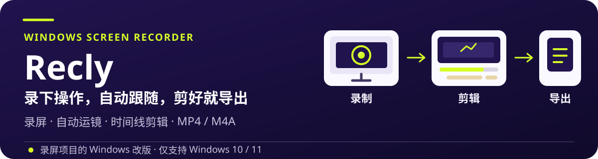
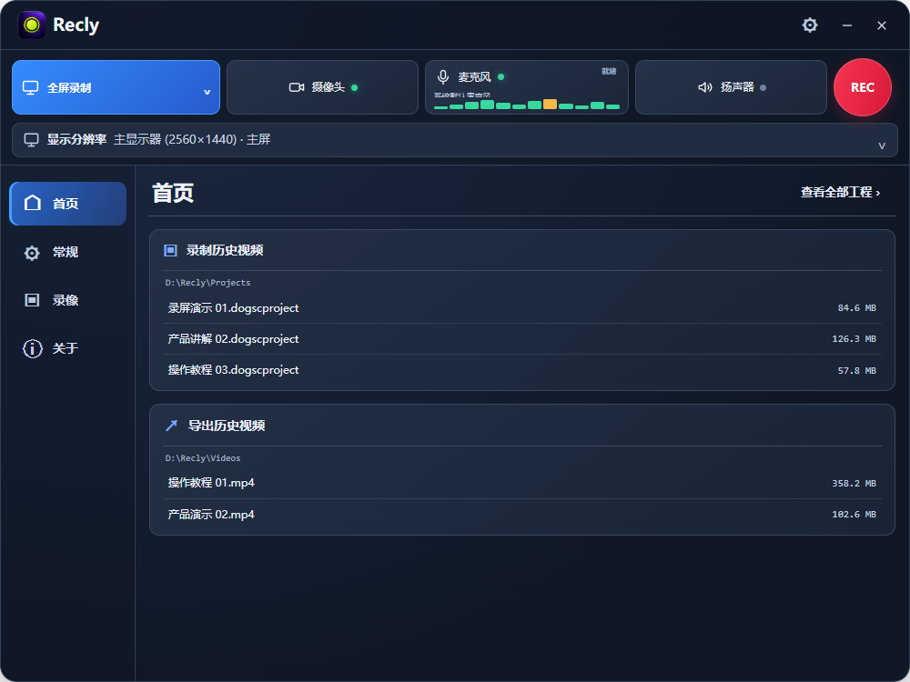
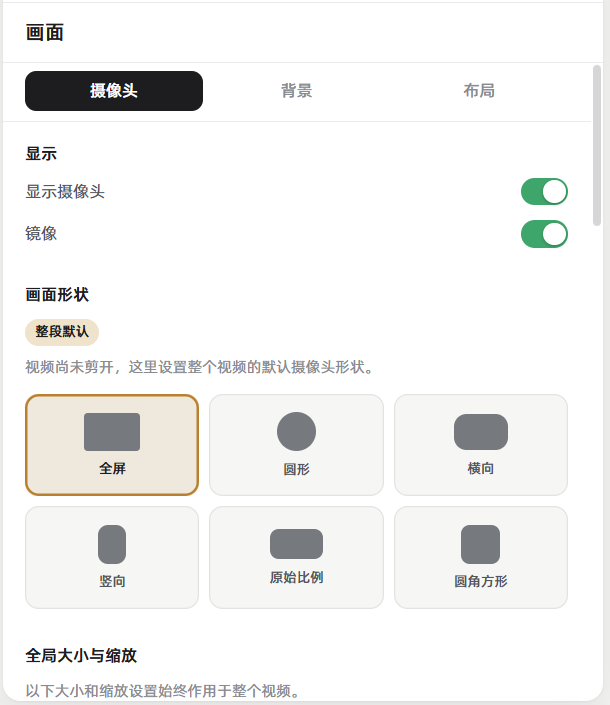
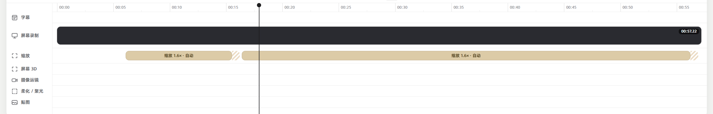

<p align="center">
  
</p>

<p align="center">
  <a href="windows/README.md"><strong>使用与开发说明</strong></a>
  · <a href="https://github.com/laogou717/dogsc">原作者项目 DogSC</a>
  · <a href="https://dqtx.cc">官网 dqtx.cc</a>
</p>

## 用录屏完成一条视频

Recly 是一款面向 Windows 的录屏与轻量剪辑工具。它把录制、自动跟随运镜、时间线编辑和导出放在一条工作流里，适合制作软件演示、操作教程和产品讲解。

<p align="center">
  
  <br><sub>按当前主控台界面源码生成的预览；历史文件名、目录和大小为示例数据。</sub>
</p>

<p align="center">
  
  <br><sub>编辑器画面设置。</sub>
</p>

<p align="center">
  
  <br><sub>编辑器时间线。</sub>
</p>

## 能做什么

当前源码版本：**0.1.2-win.3**。已接入离线语音字幕与 Agent 剪辑接口。

- **录制屏幕、窗口或自选区域**：打开软件后预热录制环境；顶部选择录制模式、麦克风、摄像头和系统声音。麦克风文字居中、底部显示实时电平，点击或右键可查看当前设备。
- **录制后直接剪辑**：停止录制并整理项目后自动打开编辑器。首页显示完整录制历史工程；双击项目进入编辑，拖动框选可批量移入回收站。
- **录制辅助窗口**：在「录像」设置中可开关提词器，支持拖边缩放；摄像头预览默认位于主屏右上角，录制素材可在编辑器中查看。
- **自动运镜跟随操作**：根据点击生成缩放片段，连续操作时镜头跟随指针；也能手动调整焦点、倍率和缓动。
- **编辑录制内容**：分割、Q/W 波纹裁切、拖动重排、恢复缺口、变速、波形与吸附。轨道空白处拖动框选时播放头保持不动；支持 Ctrl+A 全选、批量删除与一步撤销，最后一个录屏片段也能删除，空工程可保存重开。
- **清楚查看录制状态**：实际开始录制后任务栏图标显示红点，停止后清除；整理素材到编辑器显示期间保留任务栏入口，录制按钮旁不再显示计时。
- **添加配音与音乐**：音频区提供「录制配音」和「添加音乐」；可试听 / 添加 16 首内置配乐，也支持本地导入。音频片段支持移动、裁切、S / Ctrl+B 分割、调节音量并随成片导出。
- **沿用录制偏好**：新录屏沿用上次显式选择的已保存场景预设；麦克风全局与片段音量范围为 0–400%，系统声音为 0–100%。临时外观调整仅在该预设已设为新录制默认并点“更新此预设”后才用于新录屏；打开旧项目匹配到其他预设时，需先显式选择该预设或将它设为默认。
- **调整画面**：背景 / 布局 / 样机分组，浏览器地址文字可自定义；支持拖入图片、粘贴截图、画布贴图变换、虚化与仅背景显示，效果可分割、复制与粘贴属性。
- **制作动画与观看预览**：整片或单片段转场、连续屏幕 3D、摄像头运动与内部取景、相邻贴图过渡、动态图案与视频背景。默认使用流畅预览；比例工具条旁可全屏观看，Esc 退出，导出使用原始素材。
- **导出成片**：输出 MP4 视频或 M4A 音频，并选择分辨率和帧率。
- **离线字幕与翻译**：用本地 whisper.cpp 识别麦克风或系统音频，支持只识别初剪后保留的内容；字幕可清空后重识别、修改文字和时间、调整样式与动画。翻译使用已配置的 AI 后端，可替换原文或保留双语。
- **交给 Agent 接手**：通过 MCP 或命令行读取工程、剪切重排、变速、纠正字幕、预览画面和音频、保存及导出，支持撤销与重做。

## 从录制到成片

1. 选择屏幕、窗口或区域，设置麦克风、摄像头和系统声音；需要干净桌面时开启“录制时隐藏桌面图标”。
2. 停止录制后先整理素材并生成流畅预览，再自动打开编辑器；任务栏入口在交接期间保留。首页显示完整录制历史工程，双击项目进入编辑，拖动框选可批量移入回收站。
3. 在编辑器中剪切、框选和重排片段，设置运镜、背景与样机；拖入图片或粘贴截图添加贴图。Ctrl+鼠标滚轮缩放时间线，最低可缩至适应宽度的 50%。
4. 检查预览后导出 MP4 或 M4A。剪辑和效果支持保存重开、撤销与重做。

右侧编辑区按「画面 / 运镜 / 字幕 / 音频 / AI 助手」组织；光标设置位于「画面」第 4 个子页。「音频」页用于声音编辑。你可以先初剪，再让接入接口的 Agent 继续修改字幕和剪辑；也可以在编辑器的「AI 助手」选择已登录的 Codex、Claude 或 API Key 接口。识别字幕后可分析全片并分镜，安排人像全屏、屏幕加摄像头和屏幕 3D，整批操作可撤销。当前分镜依据字幕与工程参数，不自动观看视频。接入步骤见 [Agent 控制说明](windows/docs/agent-control.md)，内置助手设置见 [Windows 使用说明](windows/README.md#内置-ai-助手)。

## 运行

### 直接启动

在 Windows 上下载或克隆仓库，双击 `windows/start.bat`。首次启动会安装运行依赖。录制与导出还需要系统可调用的 FFmpeg 6.0 或更新版本：

```powershell
winget install Gyan.FFmpeg
```

### 从源码启动

需要 Windows 10 2004 或更新版本、Node.js 22.12.0+ 和 FFmpeg 6.0+。

```powershell
cd windows
npm install
npm start
```

打包 Windows 免安装目录版：

```powershell
npm run package
```

打包前需准备 `windows/runtime/whisper/` 中的识别程序、模型及其依赖，Git 仓库不包含这些二进制文件；具体目录与配置见 [字幕运行环境](windows/README.md#离线字幕与-agent-接手)。打包后的程序入口为 `windows/dist/Recly-win32-x64/Recly.exe`，运行时保留整个文件夹。打包不会覆盖旧目录；再次打包时将 `RECLY_PACKAGE_OUT` 设置为新的输出目录。更完整的说明见 [`windows/README.md`](windows/README.md)。

## 当前限制

- **仅支持 Windows。** 窗口录制采集的是可见区域，目标窗口需要保持在原位且不被遮挡。
- **语音跟随提词器尚未接入。** 现有提词器支持手动控制。
- **Agent 客户端需自行接入 MCP 或 CLI。** 需要客户端具备工具调用能力；Recly 不会自动配置所有智能体。
- **iPhone / iPad 原生有线采集尚未接入。** 投屏接收器配合窗口录制是待实机验证的方案，见 [设备录制调研](windows/docs/ios-device-recording-20261011.md)。
- **高分辨率与复杂效果会增加负载。** 默认使用代理预览；支持的 NVIDIA 环境优先采用硬件解码、缩放和编码，失败时回退。代理准备时间取决于素材与电脑配置，不保证所有设备实时预览 4K。

2026-11-15 更新的实现范围、性能实测与未通过的测试见 [本轮更新与验证](windows/docs/editor-selection-preview-20261115.md)。

本轮已验证保存重开、撤销重做、剪辑后播放及预览 / 导出一致性，详情见 [更新与验收说明](windows/docs/editor-revision-20261012.md)。

录制、音量与场景预设更新的功能范围和验收边界见[更新说明](windows/docs/recording-audio-presets-20261019.md)。

## 适配说明

Recly 的 Windows 版本以 Electron、FFmpeg 和 WebCodecs 实现录制及导出，并移植了原项目中的自动缩放、指针跟随、光标平滑和画面布局等核心逻辑。Windows 的窗口录制通过采集窗口可见区域实现，因此录制时目标窗口需要保持在原位且不被遮挡；Windows 项目文件也不与 macOS 原版互通。

## 原作者与许可

原版 DogSC 由 [神烦老狗（@laogou717）](https://github.com/laogou717) 创建，原项目和源码见 [laogou717/dogsc](https://github.com/laogou717/dogsc)。原作者未发布或背书 Recly 的 Windows 版本；原版版权声明与 MIT 许可见 [`LICENSE`](LICENSE)。再分发时请保留原作者的版权声明，字体等附带资源遵循各自许可。

## 👨‍💻 关于我

**大强同学（Derek Zhao）**
AI 工具与工作流实践者 · GitHub 开源项目作者

我在 Windows、AI Agent、Obsidian 和个人网站这些真实场景里，
把能跑通的工具、Skill 和流程，整理成可复用的开源项目与交付方案。

- 文章与工具：[dqtx.cc](https://www.dqtx.cc/) · [os.dqtx.cc](https://os.dqtx.cc/) · [blog.dqtx.cc](https://blog.dqtx.cc/)
- 关注更新：[B 站](https://space.bilibili.com/491358682/upload/video) · [YouTube](https://www.youtube.com/@dqtx760/videos) · [即刻](https://web.okjike.com/u/24236868-c3e9-49ef-ab93-93a60e1a25db) · [CSDN](https://blog.csdn.net/2402_82616859?type=blog)
- 公众号：微信搜索「大强同学」


卡在安装、配置、报错，或想把 AI 接进自己的工作流，可以直接找我。

**本软件是参考了原作者的代码进行改版，仅支持 Windows。**
