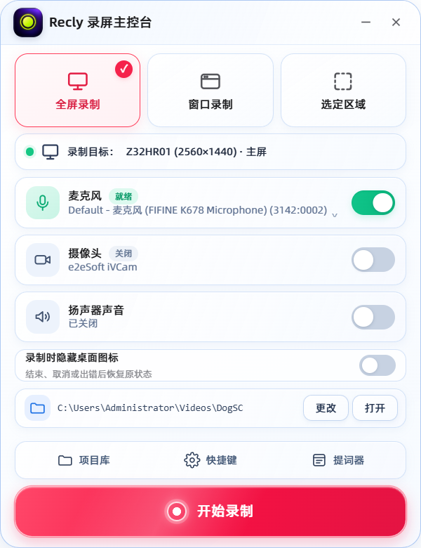

# Recly · Windows 适配版

> **原创作者：神烦老狗（[@laogou717](https://github.com/laogou717)）· 原仓库：[laogou717/dogsc](https://github.com/laogou717/dogsc)**
>
> DogSC 由原作者设计、开发并以 MIT License 开源。本目录是在原版基础上做的 Windows 适配：产品形态、界面布局、功能定义，以及 `src/core/` 里移植的算法和默认参数都来自原版。它不是原作者的官方发布，使用中的问题请在本仓库反馈，不要提到原仓库。

DogSC 原版是 macOS 原生应用（Swift + AppKit / ScreenCaptureKit / AVFoundation）。这个目录是它的 Windows 适配：外壳换成 Electron，采集和编码换成 ffmpeg 与 WebCodecs，`RecorderCore` 里的核心算法（自动缩放规划、缩放插值与视口、光标弹簧平滑、自动跟随镜头、画布与摄像头布局、导出码率策略）按原版公式和默认参数逐项移植到 `src/core/`。

录制 → 剪辑 → 运镜 → 导出 这条主线可以完整走通。

<p align="center">
  
</p>


<sub>主控台截图来自实际运行页面，编辑器截图使用自测色卡。</sub>

## 怎么用

**已打包版**：双击 `dist/Recly-win32-x64/Recly.exe`。整个 `Recly-win32-x64` 文件夹可以挪到任意位置。

**从源码运行**：双击 `start.bat`，或在本目录执行：

```bash
npm install
npm start
```

需要：Windows 10 2004 及以上（建议 Windows 11）、Node.js 22.12.0+、PATH 里有 ffmpeg 6.0 以上完整版（`winget install Gyan.FFmpeg`）。

项目保存在 `视频\DogSC\` 下，每个项目是一个 `.dogscproject` 文件夹（`project.json` + `media/`）。

## 已经适配的功能

| 原版功能 | Windows 版做法 |
| --- | --- |
| 屏幕 / 区域录制 | ffmpeg `ddagrab`（Desktop Duplication），恒定 60 帧，不录系统光标 |
| 窗口录制 | 把所选窗口切到前台，按它的可见边界采集（见下方「与原版的差异」） |
| 摄像头、麦克风、系统声音 | 各自单独成轨；摄像头与麦克风同文件录制保证口型同步；系统声音走 WASAPI 回环 |
| 录制条 / 备忘录不入画 | `WDA_EXCLUDEFROMCAPTURE`，本软件的辅助窗口不进入自己的录制画面 |
| 隐藏桌面图标 | 桌面 / 区域录制可开启；录制结束后恢复录制前的可见状态 |
| 录制完成提示 | 控制台回到待机，右下角提示保存项目或进入编辑，可继续录制下一段 |
| 悬浮备忘录 | 可拖动、调字号和背景不透明度，文稿自动保存在本机 |
| 录制标记 | 录制条上的标记按钮或 `Ctrl+Alt+M`，随项目保存，不进成片 |
| 自动缩放与自动跟随 | 按点击分组生成缩放段，连续操作时保持并跟随指针，停下后回落 |
| 手动缩放 | 时间线双击或按 `Z` 添加；可调倍率、焦点、缓动、进入 / 退出时长 |
| 时间线剪辑 | 分割、Q/W 波纹裁切、拖边裁短、缺口恢复、重排、吸附、变速（0.5×–4×）、缩略图 / 波形、撤销 / 重做 |
| 片段音量 | 每段可独立设置麦克风与系统音的音量 / 静音，或恢复继承全局设置；预览与导出共同使用 |
| 光标 | 读取 Windows 自带光标贴图重新合成；大小、平滑、静止隐藏、四种点击反馈、时间校准 |
| 摄像头排版 | 形状、大小、圆角、位置、镜像、描边、阴影、屏幕放大时让位；运动轨与蒙版内独立取景 |
| 画面设计 | 比例、源画面裁切、窗口 / 浏览器 / 手机样机、留白、位置与缩放、圆角、描边、阴影 |
| 叠加轨 | 项目内图片导入 / 剪贴板图片、位置与尺寸、相邻贴图过渡、仅背景显示、区域柔化 / 聚光 |
| 动画与背景 | 开场、连续屏幕 3D；五种图案、Windows 壁纸、自选图片、纯色、动态图案与静音视频背景 |
| 效果编辑 | 双击效果轨添加；S 分割；Ctrl+C / Ctrl+V 复制粘贴，Ctrl+Shift+V 粘贴属性 |
| 预览质量 | 流畅预览使用代理，原画预览使用源视频；隐藏窗口时暂停播放，导出始终使用源素材 |
| 导出 | MP4（H.264 + AAC）与 M4A；原始 / 1080p / 1440p / 4K，30 / 60 FPS；显示阶段、已用与预计剩余时间，可取消 |
| 离线字幕 | whisper.cpp 识别麦克风或系统音频；可识别全部源素材或初剪后保留内容，修改字幕文字、时间和样式，预览并随视频导出 |
| Agent 接口 | MCP / CLI 读取工程、剪切重排、变速、调整现有画面及声音、纠正字幕、截图 / 音频预览、保存、撤销重做和导出 |
| 项目库批量删除 | 项目库提供「全选删除」，一次确认后将所有可见项目及其素材移到 Windows 回收站；失败项目会单独提示 |

## 与原版的差异

- **窗口录制是按窗口边界做的区域采集。** 录制过程中窗口需要留在原位、不被别的窗口盖住。原因：ffmpeg 的窗口采集滤镜（`gfxcapture`）只在窗口内容变化时出帧，窗口静止时停止命令会卡住并丢掉已录内容，实测不可用。
- **光标外观是 Windows 的。** 默认"跟随录制"会按当时的光标形状在箭头、手型、文本光标之间切换。
- **剪切不做镜头接续。** 缩放、光标都以素材时间保存，剪掉一段后两侧的镜头状态各算各的；原版在剪切点做的缩放 / 光标过渡衔接没有移植。
- **项目包与 macOS 版不互通。** 字段命名对齐了原版，但素材编码和时间线结构不同。

## 新剪辑功能的使用

当前源码版本为 **0.1.2-win.3**。更新与实际验收范围见 [编辑器与录制流程修订说明](docs/editor-revision-20261012.md)。

- 录制结束后控制台回到待机，右下角提供“保存项目…”和“进入编辑”。项目已经自动保存到项目库；“保存项目…”用于复制完整项目到其他目录，也可以继续录制下一段。

- 播放头放在录屏片段内，按 **Q** 裁掉该段起点到播放头，按 **W** 裁掉播放头到该段末尾。拖动片段主体可调整顺序；「恢复缺口」选择已剪掉的源区间重新插入。
- 「波形 / 画面」切换时间线内容。「磁铁」切换吸附；拖动时按住 **Shift** 临时取消吸附。选中录屏片段后，在「声音」设置独立音量。
- 「画面」分为「背景 / 布局 / 样机」三页；浏览器样机可以自定义地址文字。预览区「+」可添加柔化 / 聚光、导入或粘贴图片，也可以拖入图片文件。选中贴图后可直接移动、缩放、旋转，设置录屏虚化或仅背景显示。图片和背景视频复制到工程的 `media/`，移动整个项目后仍可加载。
- 双击「屏幕 3D」「摄像运镜」「柔化 / 聚光」「贴图」轨添加效果。选中效果后在右侧修改；**S** 分割、**Ctrl+C / Ctrl+V** 复制粘贴、**Ctrl+Shift+V** 仅粘贴属性。粘贴时保留目标时间位置，并限制在源素材末端以内。
- 「开场」设置成片开头的动效。屏幕、摄像、贴图效果以源录制时间保存，会随对应素材剪切和重排；开场和动态背景以成片时间运行。

## 仍未完成的能力

根据文稿识别位置的语音跟随提词器、屏幕 3D 的聚焦虚化，以及完整英文产品界面尚未接入。iPhone / iPad 原生有线采集也尚未接入，方案和实机验证要求见 [设备录制调研](docs/ios-device-recording-20261011.md)。Canvas 3D 与原版渲染实现不同；剪切点的镜头接续仍见上方说明。

## 离线字幕与 Agent 接手

在编辑器的「字幕」面板选择麦克风或系统声音，以及全部源素材或剪辑保留区间，启动识别后可逐条纠错、调整时间和样式。你可以先初剪再交给 Agent，也可以录制完成后直接交给 Agent。软件提供操作接口，具体剪辑决策由所连接的 Agent 执行，没有内置自动剪辑决策。

Git 不包含 `runtime/whisper/` 下的程序和模型。源码运行与打包需要准备：

```text
runtime/whisper/
  Release/whisper-cli.exe
  Release/…                 # 与该构建配套的 DLL；CUDA 构建还需对应 CUDA 依赖
  ggml-small.bin            # 多语言模型，支持中文
```

使用与机器兼容的 whisper.cpp 构建及模型；CUDA 加速取决于 NVIDIA 显卡、驱动和构建所需的 CUDA 依赖，不保证所有 GPU 可用。`RECLY_WHISPER_EXE` 和 `RECLY_WHISPER_MODEL` 可以覆盖程序及模型路径。缺少环境时字幕面板会给出原因。打包脚本会复制实际的 `runtime/whisper/` 目录，环境变量覆盖路径不能代替待打包目录。

先启动 Recly 并打开工程，在本目录运行：

```powershell
npm run agent -- project.list
npm run agent -- project.get --params-file request.json
```

`request.json` 是 UTF-8 JSON 文件，包含 `directory`，值为 `project.list` 返回的工程目录。MCP 客户端使用 `node` 启动 `agent/recly-mcp.js` 的绝对路径；打包版脚本位于 `resources/agent/`。客户端需自行配置，并具备工具调用能力。版本校验、剪辑、字幕纠错与导出示例见 [Agent 控制说明](docs/agent-control.md)。

准备运行环境后执行 `npm run package`。打包配置为 `overwrite: false`；如默认输出目录已存在，请给 `RECLY_PACKAGE_OUT` 指定新目录：

```powershell
$env:RECLY_PACKAGE_OUT = Join-Path $PWD ('dist-' + (Get-Date -Format 'yyyyMMdd-HHmmss'))
npm run package
```

## 已知限制

- 采集会探测可用硬件编码器；支持时使用 NVIDIA GPU 转换，否则回退 CPU 转换。高分辨率、高帧率和多层柔化 / 3D 会增加负载，流畅预览可降低编辑开销；不保证所有机器实时预览 4K。
- 完整标记的 BT.709 录屏素材已做预览 / 导出比对；缺少或不完整的色彩元数据，可能在 HTML 视频与 WebCodecs 解码之间出现颜色差异。
- 多显示器按"主屏在前、其余从左到右"对应 ffmpeg 的输出序号，只在单显示器上实测过。
- 麦克风或摄像头打不开时，录制条会直接写出原因。最常见的是 Windows 隐私设置：**设置 → 隐私和安全性 → 麦克风（或摄像头）→ 允许桌面应用访问**。

## 验证

```bash
npm test          # 算法、编辑状态、音频、素材导入与渲染回归
npm run test:agent # Agent 接口、字幕与工程状态单元测试
npm run selftest  # 端到端自测，约 1 分钟
```

`selftest` 会在本机真实跑一遍：录整屏 / 窗口 / 区域 → 整理成项目 → 导出三次（原始分辨率、剪切加变速后的 1080p60、仅音频）→ 把成片解码回来核对颜色和时长，再用合成信号把"摄像头 + 麦克风 + 系统声音"的附加轨路径走一遍。期间只会弹出一个色卡窗口，不操作桌面上的其他东西，也不打开真实的麦克风和摄像头。结果写在 `%TEMP%\dogsc-selftest\report.json`。

真实 ASR 和 Electron Agent 验收需显式提供本地音频或工程夹具，私有录制不随仓库分发，要求见 [Agent 验证说明](docs/agent-control.md#验证)。

## 目录

```
src/core/       移植自 RecorderCore 的纯算法（Node 与渲染进程共用）
src/main/       主进程：窗口、ffmpeg 采集与混流、指针记录、项目整理
src/renderer/   录制条、区域 / 窗口选择、备忘录、项目库、编辑器
test/           核心算法回归
scripts/        打包脚本（npm run package）
```

界面字体来自上级目录的 `Resources/Fonts/`，Recly 图标来自 `assets/AppIconMaster.png`。

## 许可与署名

- 原版 DogSC：Copyright (c) 2026 神烦老狗，[MIT License](../LICENSE)。
- `windows/` 目录下的适配代码同样以 MIT License 发布；再分发时请保留上面的原作者版权声明。
- 随附字体（阿里巴巴普惠体）采用其自身的许可，见 [`Resources/Fonts/`](../Resources/Fonts/README.md)。
